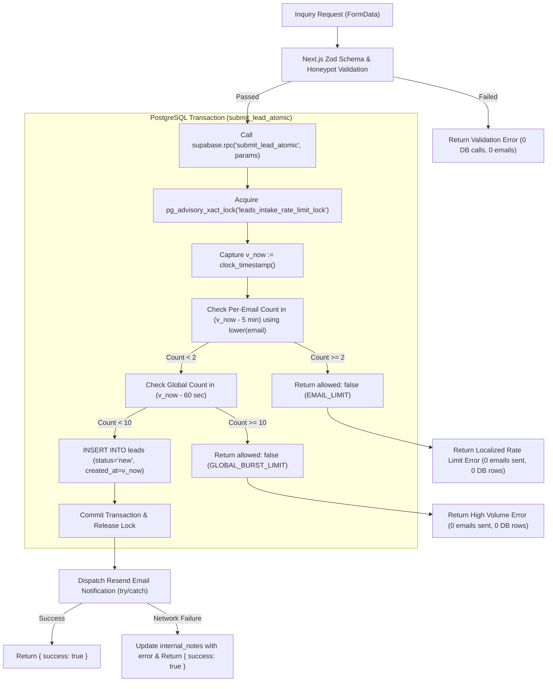

# Plan 01-02: Next.js 16 Dynamic Route Fixes, Services Route Fix, Honeypot & Atomic Server Action Validation

## Objective
Conform to Next.js 16 asynchronous dynamic parameter contracts across all dynamic routes, eliminate the 404 dead link on the services directory by adding the missing WordPress service page, integrate a client-server bot honeypot, align lead submission with the verified Supabase schema, and protect the lead intake backend with strict Zod schema validation, data normalization, and a hardened atomic PostgreSQL rate-limiting admission controller.

---

## Files Changed and Preserved

### Files Implementation Intends to Create (1 file)
1. `src/app/services/wordpress-development/page.tsx` — CREATE — Plan 01-02
   - *Filesystem verification*: Target file absent (verified); nearest existing ancestor directory is `src/app/services/` (verified present); subdirectory `wordpress-development/` will be created when file is written.
   - *Intended Change*: New service detail page matching the layout, typography, container scale, and CTA structure of existing service pages (`src/app/services/website-development/page.tsx`, `src/app/services/web-applications/page.tsx`, `src/app/services/digital-strategy/page.tsx`), resolving the 404 broken link from `/services`.

### Files Implementation Intends to Modify (4 files)
2. `src/app/work/[slug]/page.tsx` — MODIFY — Plan 01-02
   - *Filesystem verification*: Target file present on disk (verified).
   - *Intended Change*: Update `params` prop signature to `Promise<{ slug: string }>` and `await params` prior to Supabase query execution per Next.js 16 conventions; retain `notFound()`.
3. `src/app/insights/[slug]/page.tsx` — MODIFY — Plan 01-02
   - *Filesystem verification*: Target file present on disk (verified).
   - *Intended Change*: Update `params` prop signature to `Promise<{ slug: string }>` and make component `async` to `await params` per Next.js 16 conventions; retain `notFound()`.
4. `src/components/ProjectInquiryForm.tsx` — MODIFY — Plan 01-02
   - *Filesystem verification*: Target file present on disk (verified).
   - *Intended Change*: Add hidden honeypot input field (`bot_field`) within the form markup so it is transmitted in `FormData`; provide localized, actionable error feedback.
5. `src/app/actions/submit-inquiry.ts` — MODIFY — Plan 01-02
   - *Filesystem verification*: Target file present on disk (verified).
   - *Intended Change*: Implement Zod schema validation, input normalization, honeypot checking, verified schema alignment (omitting non-existent `service_interest_ids`), and atomic RPC integration (`submit_lead_atomic`) with resilient Resend error handling.

*(Total repository files touched in Plan 01-02: 5 files — 1 created, 4 modified)*

### Existing Files That Must Remain UNCHANGED
- `src/app/services/page.tsx`: The catalog link `/services/wordpress-development` is preserved as-is.
- `src/app/services/website-development/page.tsx`, `src/app/services/web-applications/page.tsx`, `src/app/services/mobile-app-development/page.tsx`, `src/app/services/seo/page.tsx`, `src/app/services/maintenance/page.tsx`, `src/app/services/digital-strategy/page.tsx`: All existing service pages remain untouched.
- `src/components/Header.tsx`, `src/components/Footer.tsx`, `src/components/HorizontalScroll.tsx`, `src/components/ServicesGrid.tsx`: Preserved without alteration.
- `src/app/layout.tsx`: HTML framing, font imports, persistent header/footer structure remain intact.
- `tailwind.config.js` & `src/app/globals.css`: Color tokens (`navy`, `blue`, `yellow`), typography, and design tokens remain untouched.
- `package.json`: No new dependencies or paid services added.

---

## Technical Analysis & Ground Truth Verification

### Live Supabase Schema & Diagnostic Probe History
1. **Schema Fields Verified**:
   - Confirmed columns in `public.leads`: `id` (uuid), `name` (text), `email` (text), `company` (text), `website` (text), `phone` (text), `service_interests` (jsonb/text), `budget_range` (text), `timeline` (text), `project_summary` (text), `source_page` (text), `utm_source`, `utm_medium`, `utm_campaign`, `consent_status` (jsonb), `status` (text), `assigned_to`, `internal_notes`, `created_at` (timestamptz), `updated_at` (timestamptz).
   - **Critical Schema Defect Fixed**:
     The original `src/app/actions/submit-inquiry.ts` passed `service_interest_ids: []`. The `leads` table does **not** possess a `service_interest_ids` column, producing PostgREST error `PGRST204: Could not find the 'service_interest_ids' column of 'leads' in the schema cache`. Implementation omits `service_interest_ids` and passes only valid columns (`name`, `email`, `project_summary`, `status`).
   - `created_at` is confirmed present with default `now()`.

2. **Accurate Reporting of Diagnostic Probe History**:
   - Diagnostic probes executed during earlier planning turns modified live data in `public.leads` by inserting three temporary records, modifying a record via UPDATE, and issuing DELETE queries.
   - Cleanup of these specific test records was confirmed only to the extent supported by the recorded probe outputs (which reported successful DELETE operations matching probe IDs and probe emails).
   - A subsequent read-only count query confirmed that `public.leads` contained zero rows at that specific point in time; this confirms the table was empty at that check, not that real customer data never existed prior to that check.
   - No further mutating probes are permitted or executed.

3. **Supabase Permissions & RLS Finding**:
   - The server uses `SUPABASE_SERVICE_KEY`, which provides administrative access to `leads`.
   - Inspection probe revealed that the public anon key (`NEXT_PUBLIC_SUPABASE_ANON_KEY`) currently has unrestricted `SELECT` access to `leads` directly via PostgREST. The Zero-Exposure RLS lockdown migration is specified as an unapplied deployment migration.

---

## Concurrency Analysis & Genuinely Atomic Rate Limiting

### Vulnerability of "Count-Then-Insert" Limiter
A check-then-act pattern (`SELECT count(*) -> if count < 10 -> INSERT + send email`) is vulnerable to a classic **Time-of-Check to Time-of-Use (TOCTOU) concurrency race condition**.
If 50 requests arrive concurrently within a 100ms window:
- All 50 threads query count simultaneously; all 50 observe count < 10.
- All 50 threads proceed to insert rows and call `resend.emails.send()`.
- Result: 50 emails are sent, breaching the 10-email limit and exhausting transactional email quotas.

### Genuinely Atomic PostgreSQL Architecture (`pg_advisory_xact_lock`)
To achieve true concurrency serialization without external paid caching services (e.g. Upstash Redis), implementation uses a **PostgreSQL Stored Function with an Advisory Transaction Lock (`public.submit_lead_atomic`)**:



1. **Transaction & Locking Strategy**:
   - `pg_catalog.pg_advisory_xact_lock(pg_catalog.hashtext('leads_intake_rate_limit_lock'))` acquires an exclusive in-memory lock within PostgreSQL's transaction manager **first**, before any reads, counts, or timestamps are evaluated.
   - Scoped strictly to the transaction (`xact`), automatically released upon commit or rollback.
   - All concurrent incoming inquiries queue in FIFO order for only 1–3ms per execution.
2. **Consistent Wall-Clock Timestamp Capture**:
   - Immediately after acquiring the lock, the function captures `v_now := pg_catalog.clock_timestamp();`.
   - `clock_timestamp()` reflects the true wall-clock time after lock acquisition (unlike `now()`, which reflects statement start time prior to queueing).
   - `v_now` is used consistently across the 5-minute per-email check, the 60-second global surge check, and the inserted row's `created_at` and `updated_at`.
3. **Consistent Email Normalization**:
   - The per-email check normalizes comparisons against any existing records (including pre-existing mixed-case rows):
     `WHERE pg_catalog.lower(email) = pg_catalog.lower(pg_catalog.trim(p_email)) AND created_at >= (v_now - pg_catalog.interval '5 minutes')`.
   - The inserted row stores the normalized lowercase email (`pg_catalog.lower(pg_catalog.trim(p_email))`).
4. **Atomic Rate Limit Checks**:
   - **Per-Email Frequency Cap**: If count >= 2 in the 5-minute window, returns `allowed: false`.
   - **Global Surge Cap**: If count >= 10 in the 60-second window, returns `allowed: false`.
5. **Zero Junk Insert on Rejection**:
   - Only when both checks pass is the row inserted into `public.leads` with `status: 'new'`.
   - If either check fails, **zero rows are inserted**, eliminating table bloat from spam attacks.

### Rate-Limit Admission vs. External Resend Delivery Guarantee

#### What the Database Transaction Guarantees
- The PostgreSQL transaction guarantees **rate-limit admission and an allocated notification slot**.
- It guarantees that under any concurrent burst, no more than 10 submissions per rolling 60-second window will be admitted into `public.leads` and granted an email dispatch attempt.
- It guarantees that no more than 2 submissions for the same email address per rolling 5-minute window will be admitted.

#### What the Database Transaction Does NOT Guarantee
- The database transaction commits **before** the external Resend HTTP request is dispatched.
- The transaction alone does **not** guarantee that external network delivery will succeed, nor that the actual Resend HTTP dispatch requests will strictly complete within that exact 60-second wall-clock window (external network latency, DNS resolution, or Resend API response lag can cause HTTP completions to occur slightly outside the window).
- Distinguish clearly between:
  1. **Database Admission**: The lead record is validated, accepted, and committed to `public.leads` under the advisory lock.
  2. **Allocated Notification Slot**: Permission granted by the admission controller to attempt external email notification.
  3. **Resend API Acceptance**: Resend HTTP endpoint returns `200 OK` with an email message ID (`{ id: '...' }`).
  4. **Actual Email Delivery**: Downstream mail transfer agents (MTAs) and recipient mail servers delivering the email to `hello@bluesandyellow.agency` inbox.

#### Limitation on Strict Network Dispatch Windows & Smallest Safe Design
- If a strict guarantee on actual external network dispatch times were required (e.g., guaranteed <= 10 outgoing HTTP requests per wall-clock minute regardless of network lag), that would require an out-of-process persistent rate-limited worker queue (e.g. PgBoss, Celery, or Redis queue).
- Adding a background queue worker would require a schema addition (a job queue table), a persistent daemon runner, and added operational complexity. This would represent an unapproved scope expansion.
- **Smallest Safe Design Compatible with Existing Zero-Dependency Stack**:
  - **Immediate Post-Commit Dispatch with Error Compensation**: The Server Action attempts Resend dispatch immediately after the admission transaction commits, wrapped in `try/catch`.
  - **Resend Failure Handling Policy**:
    1. *Successful Admission & Resend Acceptance*: Lead is saved in `public.leads`, Resend accepts message, action returns `{ success: true }`, client sees confirmation.
    2. *Resend Error or Timeout After Lead Committed*: The lead remains safely persisted in `public.leads` with `status: 'new'`—prospective customer data is never lost. The Server Action catches the exception and logs the failure in `internal_notes`:
       `await supabase.from('leads').update({ internal_notes: 'Resend dispatch failed: ' + error.message }).eq('id', data.lead_id);`.
       The Server Action returns `{ success: true }` to the prospective client so they do not receive an ambiguous failure message and repeatedly submit duplicate inquiries.
    3. *Repeated Customer Submission After Ambiguous Client Timeout*: If a customer's browser experiences a timeout and the user clicks submit again, a 2nd submission with the same email within 5 minutes is admitted (up to the per-email cap of 2). A 3rd submission is rejected by `submit_lead_atomic`, preventing submission flooding.
    4. *Notification Follow-Up Without Automatic Retry Queue*: Agency staff reviewing `/admin/leads` inspect records with `internal_notes LIKE 'Resend dispatch failed%'` to manually follow up. If an automated retry mechanism is desired in the future, it must be planned as a separate, approved milestone.

---

## Unapplied Deployment Migrations (Supabase SQL Editor)

## Unapplied Deployment Migrations (Supabase SQL Editor)

### Database Ownership, RLS Interaction & Deployment Blocker

#### 1. Rigorous Separation of Database Roles
Static repository inspection confirms that zero `.sql` migration files, DDL schema files, or database connection strings (`DATABASE_URL`) exist in the repository. The application interacts with Supabase exclusively via the HTTPS PostgREST/Auth API using API keys (`NEXT_PUBLIC_SUPABASE_ANON_KEY`, `SUPABASE_SERVICE_ROLE_KEY`).

To analyze database authorization accurately without speculative assumptions, four distinct entities/roles must be clearly separated:
1. **The Active Session Role (`current_user`, `session_user`)**: The role under which a connected database client (e.g. Supabase Dashboard SQL Editor or CLI session) executes queries. Querying `SELECT current_user, session_user;` only reports the identity of the current connection; it does **not** verify the table owner of existing tables, nor does it prove which role will own future functions unless created in that exact session without role switching.
2. **The Actual Owner of `public.leads`**: The role recorded in PostgreSQL's system catalog (`pg_tables.tableowner`). In PostgreSQL, standard Row Level Security (`ENABLE ROW LEVEL SECURITY` without `FORCE`) automatically exempts **only** the table owner (and roles with the `rolbypassrls` attribute). If `public.leads` is owned by a different role than the session role, the session role does not bypass RLS unless it possesses `rolsuper` or `rolbypassrls`.
3. **The Role That Will Own `public.submit_lead_atomic`**: When `CREATE FUNCTION` is executed, the function's owner defaults to the active `current_user` of the creating session (unless altered via `ALTER FUNCTION ... OWNER TO`). Because the function is declared `SECURITY DEFINER`, PostgreSQL executes its internal statements under the identity and permissions of the **function owner**.
4. **Required Table Privileges and RLS Behavior for the Function Owner**:
   - *Function Owner Privileges Needed*: The function body of `public.submit_lead_atomic` performs only read queries (counting rolling submissions) and an insert query (persisting admitted lead records). It contains **zero** `UPDATE` statements. Therefore, statements inside the function body strictly require only `SELECT` and `INSERT` privileges on `public.leads` for the function owner.
   - *Separate Server Action Privileges Needed*: The `UPDATE` operation occurs outside the stored procedure, inside the separate Next.js Server Action (`src/app/actions/submit-inquiry.ts`), which runs on the server under the `service_role` client to record Resend dispatch failures in `internal_notes`. Therefore, `UPDATE` (along with `SELECT`, `INSERT`, and `EXECUTE` on the function) is required solely by the `service_role` backend client, not by the function owner.
   - *RLS Behavior*: If the function owner is NOT the table owner of `public.leads` and lacks `rolbypassrls`, all queries inside the function are constrained by `public.leads`'s RLS policies.
   - *Unsafe Assumptions Rejected*: It must **not** be assumed that the table owner is `postgres`, that the function owner will be `postgres`, that the executing role possesses `rolbypassrls`, or that an RLS policy granting `postgres` access automatically covers the actual owner. Granting unverified roles access in an RLS policy violates least privilege.

#### 2. Read-Only Evidence Needed to Establish Facts
Before either migration can be approved or executed, the database administrator must execute the following read-only inspection queries in the Supabase Dashboard SQL Editor to establish empirical ground truth:
```sql
-- Check 1: Verify actual owner of public.leads table
SELECT schemaname, tablename, tableowner
FROM pg_tables
WHERE schemaname = 'public' AND tablename = 'leads';

-- Check 2: Verify active session role in the SQL Editor
SELECT current_user, session_user;

-- Check 3: Inspect role attributes (superuser, bypassrls) for session role and table owner
SELECT rolname, rolsuper, rolbypassrls, rolcanlogin
FROM pg_roles
WHERE rolname IN (current_user, (SELECT tableowner FROM pg_tables WHERE schemaname = 'public' AND tablename = 'leads'));

-- Check 4: Inspect existing grants on public.leads
SELECT grantee, privilege_type
FROM information_schema.role_table_grants
WHERE table_schema = 'public' AND table_name = 'leads';
```

#### 3. Verification Status: UNVERIFIED & Deployment Blocker
- **Database Roles & Ownership Status**: **UNVERIFIED**. Because establishing these four facts requires executing SQL queries against the live database catalog, and no SQL execution is permitted during Phase 1 planning, the table owner, session role, future function owner, and RLS bypass attributes are unverified.
- **Deployment Status**: **DEPLOYMENT REMAINS BLOCKED**. Both migrations remain strictly unapplied. Deployment cannot proceed until the administrator executes the 4 read-only verification queries above, establishes the true table owner and function owner, and reviews the RLS policy accordingly.

#### 4. Proposed RLS Design
The RLS design strictly denies direct access to `public.leads` for `anon` and `authenticated`, while preserving the backend server-side `service_role` workflow:
1. **Enable Standard RLS**: `ALTER TABLE public.leads ENABLE ROW LEVEL SECURITY;` (without `FORCE`).
2. **Deny All External Roles**:
   - `REVOKE ALL ON TABLE public.leads FROM anon;`
   - `REVOKE ALL ON TABLE public.leads FROM authenticated;`
   - `REVOKE ALL ON TABLE public.leads FROM public;`
   - Drop legacy permissive policies to enforce default-deny.
3. **Preserve Service-Role Workflow (Narrowest Explicit Privileges)**:
   - `GRANT SELECT, INSERT, UPDATE ON TABLE public.leads TO service_role;` (narrowest explicit table privileges required: `SELECT` for admin leads dashboard, `INSERT` for lead intake, `UPDATE` for Resend dispatch error logging; withholds `DELETE`, `TRUNCATE`, `REFERENCES`, and `TRIGGER`).
   - `CREATE POLICY "Service role full access on leads" ON public.leads FOR ALL TO service_role USING (true) WITH CHECK (true);`
4. **Function Owner Access Resolution (No Unverified Roles Granted)**:
   - If Checks 1–3 confirm the function owner is the table owner or has `rolbypassrls`, standard RLS requires no extra policy for the function owner.
   - If the function owner is a distinct role without `rolbypassrls` and is not the table owner, the administrator must either:
     a) Align function ownership with the table owner: `ALTER FUNCTION public.submit_lead_atomic(text, text, text) OWNER TO <verified_table_owner>;`, OR
     b) Create an explicit policy for the verified function owner role only after establishing its identity:
        `CREATE POLICY "Function owner access on leads" ON public.leads FOR ALL TO <verified_function_owner> USING (true) WITH CHECK (true);`.
   - Under no circumstances is access granted to unverified or arbitrary roles.
5. **Function Execution Privilege**:
   - `REVOKE ALL ON FUNCTION public.submit_lead_atomic(text, text, text) FROM PUBLIC, anon, authenticated;`
   - `GRANT EXECUTE ON FUNCTION public.submit_lead_atomic(text, text, text) TO service_role;`

---

### Migration 1: Zero-Exposure RLS Lockdown for `public.leads`
To be executed in the Supabase Dashboard SQL Editor before Phase 1 deployment (pending prerequisite verification):

```sql
-- ==============================================================================
-- Migration: Zero-Exposure RLS Lockdown for public.leads
-- Purpose: Completely revoke external PostgREST access from anon and authenticated
--          roles while preserving backend server-side service-role operations.
-- Prerequisite: Execute Checks 1-4 above to verify roles before applying.
-- ==============================================================================

-- 1. Enable standard Row Level Security on the table (do NOT use FORCE)
ALTER TABLE public.leads ENABLE ROW LEVEL SECURITY;

-- 2. Revoke all direct privileges from untrusted external roles
REVOKE ALL ON TABLE public.leads FROM anon;
REVOKE ALL ON TABLE public.leads FROM authenticated;
REVOKE ALL ON TABLE public.leads FROM public;

-- 3. Drop any legacy policies to guarantee default-deny
DROP POLICY IF EXISTS "Allow anonymous insert on leads" ON public.leads;
DROP POLICY IF EXISTS "Allow anonymous read on leads" ON public.leads;
DROP POLICY IF EXISTS "Allow authenticated admin full access to leads" ON public.leads;

-- 4. Explicitly grant narrowest required table permissions to service_role
-- Grants SELECT (admin listing), INSERT (intake), UPDATE (error logging); withholds DELETE, TRUNCATE, etc.
GRANT SELECT, INSERT, UPDATE ON TABLE public.leads TO service_role;

-- 5. Explicitly permit service_role under RLS (only verified backend service role)
DROP POLICY IF EXISTS "Backend service and owner full access on leads" ON public.leads;
DROP POLICY IF EXISTS "Service role full access on leads" ON public.leads;
CREATE POLICY "Service role full access on leads"
ON public.leads
FOR ALL
TO service_role
USING (true)
WITH CHECK (true);

-- Note on Function Owner: If Checks 1-3 establish that the function owner is not
-- the table owner and lacks BYPASSRLS, either run:
--   ALTER FUNCTION public.submit_lead_atomic(text, text, text) OWNER TO <verified_table_owner>;
-- OR create a targeted policy for that verified role:
--   CREATE POLICY "Function owner full access on leads" ON public.leads FOR ALL TO <verified_function_owner> USING (true) WITH CHECK (true);
```

### Migration 2: Hardened Atomic Rate-Limiting Stored Function
To be executed in the Supabase Dashboard SQL Editor before Phase 1 deployment:

```sql
-- ==============================================================================
-- Function: public.submit_lead_atomic
-- Purpose: Atomically validate rate limits and insert leads using transaction locking.
-- Security: SECURITY DEFINER with empty search_path and explicit schema qualification.
-- Privileges: Restricted exclusively to service_role; revoked from anon/authenticated.
-- ==============================================================================

CREATE OR REPLACE FUNCTION public.submit_lead_atomic(
  p_name text,
  p_email text,
  p_project_summary text
) RETURNS pg_catalog.jsonb
LANGUAGE plpgsql
SECURITY DEFINER
SET search_path = ''
AS $$
DECLARE
  v_now timestamptz;
  v_email_count int;
  v_global_count int;
  v_lead_id uuid;
  v_created_at timestamptz;
BEGIN
  -- 1. Acquire transaction-level advisory lock first
  -- Held strictly for current transaction; auto-released on commit or rollback
  PERFORM pg_catalog.pg_advisory_xact_lock(pg_catalog.hashtext('leads_intake_rate_limit_lock'));

  -- 2. Capture clock_timestamp() once immediately after acquiring lock
  v_now := pg_catalog.clock_timestamp();

  -- 3. Check Per-Email Frequency Limit (max 2 submissions per rolling 5-minute window)
  -- Case-insensitive comparison against p_email using valid pg_catalog.btrim function
  SELECT pg_catalog.count(*)
  INTO v_email_count
  FROM public.leads
  WHERE pg_catalog.lower(email) = pg_catalog.lower(pg_catalog.btrim(p_email))
    AND created_at >= (v_now - pg_catalog.interval '5 minutes');

  IF v_email_count >= 2 THEN
    RETURN pg_catalog.jsonb_build_object(
      'allowed', false,
      'code', 'EMAIL_RATE_LIMIT_EXCEEDED',
      'error', 'Too many submissions for this email address. Please wait a few minutes before trying again.'
    );
  END IF;

  -- 4. Check Global Surge Limit (max 10 submissions per rolling 60-second window)
  SELECT pg_catalog.count(*)
  INTO v_global_count
  FROM public.leads
  WHERE created_at >= (v_now - pg_catalog.interval '60 seconds');

  IF v_global_count >= 10 THEN
    RETURN pg_catalog.jsonb_build_object(
      'allowed', false,
      'code', 'GLOBAL_RATE_LIMIT_EXCEEDED',
      'error', 'Submission volume is unusually high. Please wait a moment and try again.'
    );
  END IF;

  -- 5. Atomic Insert (Only executed when both limits pass)
  INSERT INTO public.leads (
    name,
    email,
    project_summary,
    status,
    created_at,
    updated_at
  ) VALUES (
    p_name,
    pg_catalog.lower(pg_catalog.btrim(p_email)),
    p_project_summary,
    'new',
    v_now,
    v_now
  )
  RETURNING id, created_at INTO v_lead_id, v_created_at;

  RETURN pg_catalog.jsonb_build_object(
    'allowed', true,
    'lead_id', v_lead_id,
    'created_at', v_created_at
  );
END;
$$;

-- Revoke execute permissions from all public roles
REVOKE ALL ON FUNCTION public.submit_lead_atomic(text, text, text) FROM PUBLIC, anon, authenticated;

-- Grant execution privilege exclusively to service_role
GRANT EXECUTE ON FUNCTION public.submit_lead_atomic(text, text, text) TO service_role;

-- Ensure narrowest required table privileges on public.leads for service_role
GRANT SELECT, INSERT, UPDATE ON TABLE public.leads TO service_role;
```

#### Function Owner, RLS & Privilege Documentation
- **SECURITY DEFINER Execution**: When executed, `submit_lead_atomic` runs with the privileges of its owner (the role creating the function in the Supabase Dashboard, defaulting to the session user unless altered).
- **Owner Verification Status**: **UNVERIFIED**. Static repository evidence cannot confirm the active session role, table owner, or function owner without database inspection queries. Deployment remains blocked pending verification of the executing role and table owner in the Supabase SQL Editor via Checks 1–4.
- **Privilege Separation (Function Owner vs. Server Action)**:
  - The body of `public.submit_lead_atomic` contains zero `UPDATE` statements; its statements strictly perform rolling-window counts (`SELECT`) and new lead creation (`INSERT`). Thus, the function owner strictly requires `SELECT` and `INSERT` on `public.leads`.
  - The separate Server Action (`src/app/actions/submit-inquiry.ts`) executes under `service_role` to invoke the function (`EXECUTE`) and update `internal_notes` (`UPDATE`) if Resend email dispatch fails. Thus, `UPDATE` is required solely by the `service_role` client, not the function owner.
- **Safe Search Path**: `SET search_path = ''` mitigates schema search-path hijacking attacks. All database objects (`public.leads`), types (`pg_catalog.timestamptz`, `pg_catalog.int4`, `pg_catalog.uuid`, `pg_catalog.jsonb`), and functions (`pg_catalog.pg_advisory_xact_lock`, `pg_catalog.clock_timestamp`, `pg_catalog.btrim`, `pg_catalog.lower`, `pg_catalog.count`, `pg_catalog.interval`, `pg_catalog.jsonb_build_object`) are strictly schema-qualified.
- **Resolution of Function Owner & RLS Interaction (No Unverified Roles Granted)**:
  - The function is invoked by the Server Action using the `service_role` key, but inside `submit_lead_atomic` it executes as the function owner.
  - The migration enables standard RLS (`ENABLE ROW LEVEL SECURITY` without `FORCE`) and grants full access strictly to `service_role`.
  - No unverified roles are granted access in the RLS policy.
  - If Checks 1–3 confirm the function owner is the table owner or has `rolbypassrls`, it bypasses standard RLS automatically.
  - If the function owner is a distinct role without `rolbypassrls` and is not the table owner, the administrator must either:
    1. Align function ownership: `ALTER FUNCTION public.submit_lead_atomic(text, text, text) OWNER TO <verified_table_owner>;`, OR
    2. Add an explicit policy for that verified role only after verifying its identity:
       `CREATE POLICY "Function owner access on leads" ON public.leads FOR ALL TO <verified_function_owner> USING (true) WITH CHECK (true);`.
- **Zero Public Access**: Because `REVOKE ALL ... FROM PUBLIC, anon, authenticated` is enforced on both the table and the function, external PostgREST callers cannot query the table or execute this function. Only the backend `service_role` can execute it via `supabase.rpc()`.

---

## Tasks

### Task 1: Next.js 16 Asynchronous Dynamic Route Migration
- **Files**: `src/app/work/[slug]/page.tsx`, `src/app/insights/[slug]/page.tsx`
- **Action**:
  1. In `src/app/work/[slug]/page.tsx`:
     - Update component prop typing from `{ params }: { params: { slug: string } }` to `{ params }: { params: Promise<{ slug: string }> }`.
     - In function body, await `params`: `const { slug } = await params;`.
     - Use `slug` in Supabase query: `.eq('slug', slug)`.
     - Preserve existing `notFound()` check when `error || !project`.
     - Preserve existing case study layout, typography (`text-[var(--text-body)]`), and section headers.
  2. In `src/app/insights/[slug]/page.tsx`:
     - Change function signature to `export default async function ArticlePage({ params }: { params: Promise<{ slug: string }> })`.
     - Await `params`: `const { slug } = await params;`.
     - Format and display slug in `<h1>` cleanly without synchronous access warnings.
- **Verification**:
  - Visit `/work/project-alpha` and `/insights/scalable-web-apps`; verify server logs emit zero warnings regarding synchronous `params` access.
  - Visit an invalid slug `/work/nonexistent-project-xyz`; verify Next.js renders the 404 page gracefully.
- **Regression Check**:
  - Confirm page styling, prose width (`max-w-4xl`), and typography remain identical to original.

### Task 2: Service Route 404 Resolution (WordPress & CMS)
- **Files**: `src/app/services/wordpress-development/page.tsx`
- **Action**:
  1. Create directory `src/app/services/wordpress-development/` and file `src/app/services/wordpress-development/page.tsx`.
  2. Implement `WordPressDevelopment` server component matching the exact structure and design tokens of `src/app/services/website-development/page.tsx`:
     - Container: `bg-white py-20` > `container mx-auto px-6 max-w-4xl`.
     - Heading: `text-[var(--text-display)] font-bold text-[var(--navy)] mb-8` with title `"WordPress & CMS Development"`.
     - Subtitle: `text-[var(--text-h3)] text-[var(--text-secondary)] mb-16` describing custom WordPress themes, WooCommerce, and headless CMS platforms.
     - Content sections: 2-column grid (`grid md:grid-cols-2 gap-12`) with "What We Deliver" (Custom Theme Development, Headless Architecture, Performance Tuning, Security Hardening, Seamless Migrations) and "Why Work With Us" (Clean code standards, Gutenberg & ACF expertise, ongoing security updates, accessibility compliance).
     - Call-to-action: Link to `/start-a-project` styled with `bg-[var(--blue)] text-white px-8 py-4 rounded-full font-semibold hover:bg-[var(--navy)] transition inline-block` ("Request a Proposal").
- **Verification**:
  - Visit `/services` and click the "WordPress & CMS" card; verify it navigates to `/services/wordpress-development` and returns HTTP 200 with complete content.
- **Regression Check**:
  - Verify all other service links on `/services` (`website-development`, `web-applications`, `mobile-app-development`, `seo`, `maintenance`, `digital-strategy`) continue to work without disruption.

### Task 3: Honeypot Integration in Inquiry Form
- **Files**: `src/components/ProjectInquiryForm.tsx`
- **Action**:
  1. In `src/components/ProjectInquiryForm.tsx`, add an inaccessible honeypot input field inside the `<form action={handleSubmit}>`:
     ```tsx
     <div className="opacity-0 absolute -left-[9999px] h-0 w-0 overflow-hidden" aria-hidden="true" tabIndex={-1}>
       <label htmlFor="bot_field">Leave this field blank</label>
       <input
         id="bot_field"
         name="bot_field"
         type="text"
         tabIndex={-1}
         autoComplete="off"
       />
     </div>
     ```
  2. Preserve all existing state handling (`'idle' | 'submitting' | 'success' | 'error'`), button disabled states, input labels, and Tailwind styling classes.
- **Verification**:
  - Inspect `/start-a-project` in browser: the honeypot field is invisible to users and skipped by keyboard tab navigation, but is included in `FormData` on submission.
- **Regression Check**:
  - Normal form appearance and responsiveness across mobile and desktop are identical.

### Task 4: Server Action Schema Alignment, Zod Validation, Atomic RPC & Resend Resilience
- **Files**: `src/app/actions/submit-inquiry.ts`
- **Action**:
  1. Import `z` from `zod`.
  2. Define validation schema:
     ```typescript
     const inquirySchema = z.object({
       name: z
         .string()
         .trim()
         .min(2, 'Name must be at least 2 characters')
         .max(100, 'Name must not exceed 100 characters'),
       email: z
         .string()
         .trim()
         .email('Please enter a valid email address')
         .max(255, 'Email must not exceed 255 characters'),
       message: z
         .string()
         .trim()
         .min(10, 'Project summary must be at least 10 characters')
         .max(5000, 'Project summary must not exceed 5000 characters'),
       bot_field: z.string().optional()
     });
     ```
  3. Validate `FormData` values:
     - Check honeypot: If `formData.get('bot_field')` contains any non-empty string, immediately return `{ success: true }` (silent discard) without writing to DB or invoking Resend.
     - Parse input with `inquirySchema.safeParse(...)`. If validation fails, return `{ success: false, error: parsed.error.issues[0].message }`.
  4. Normalize data:
     - `normalizedName`: trimmed of excess whitespace, preserving legitimate international characters, apostrophes (e.g. O'Connor), accents, and hyphens.
     - `normalizedEmail`: trimmed and converted to lower case (`email.trim().toLowerCase()`).
     - `normalizedMessage`: trimmed of leading/trailing whitespace, preserving newlines and punctuation.
  5. Execute Atomic PostgreSQL Rate Limiting & Insertion:
     - Invoke PostgreSQL stored function `submit_lead_atomic`:
       ```typescript
       const { data, error } = await supabase.rpc('submit_lead_atomic', {
         p_name: normalizedName,
         p_email: normalizedEmail,
         p_project_summary: normalizedMessage,
       });
       ```
     - If the RPC returns `allowed: false` or error:
       Return `{ success: false, error: data?.error || 'Unable to process inquiry at this time.' }` immediately. No Resend email is sent; no junk rows are written.
     - If the RPC returns `allowed: true`:
       Execute Resend dispatch wrapped in `try/catch`:
       ```typescript
       try {
         await resend.emails.send({
           from: 'inquiries@bluesandyellow.agency',
           to: 'hello@bluesandyellow.agency',
           subject: `New Project Inquiry: ${normalizedName}`,
           text: `New lead: ${normalizedName} (${normalizedEmail})\nMessage: ${normalizedMessage}`,
         });
       } catch (emailError: any) {
         console.error('Failed to send Resend email notification:', emailError);
         await supabase.from('leads').update({
           internal_notes: `Resend notification failed: ${emailError?.message || 'Unknown network error'}`
         }).eq('id', data.lead_id);
       }
       return { success: true };
       ```
- **Verification**:
  - Run validation tests for invalid name, invalid email, and short message.
  - Run rate limit test with duplicate email submissions within 5 minutes.
  - Test concurrent submission simulation with distinct emails.
  - Test simulated Resend failure: lead row is committed, client receives `{ success: true }`.
- **Regression Check**:
  - Successful inquiry triggers green "Thank you!" panel on `/start-a-project`.

---

## Explicit Acceptance Tests

> [!IMPORTANT]
> The acceptance tests below specify the verification criteria for Phase 1 implementation. Do not claim these tests passed until they have actually been executed during execution.

### Category A: Security & Access Control
1. **Anonymous PostgREST Direct CRUD Denial**:
   - `curl -s -X GET "https://<supabase-url>/rest/v1/leads" -H "apikey: <anon-key>"` -> HTTP 401 / 42501 (denied).
   - `curl -s -X POST "https://<supabase-url>/rest/v1/leads" -H "apikey: <anon-key>"` -> HTTP 401 / 42501 (denied).
   - `curl -s -X PATCH "https://<supabase-url>/rest/v1/leads?id=eq.any" -H "apikey: <anon-key>"` -> HTTP 401 / 42501 (denied).
   - `curl -s -X DELETE "https://<supabase-url>/rest/v1/leads?id=eq.any" -H "apikey: <anon-key>"` -> HTTP 401 / 42501 (denied).
2. **Unauthenticated & Forged Admin Session Access**:
   - Unauthenticated GET `/admin/leads` -> Redirects to `/admin/login?next=%2Fadmin%2Fleads`; zero lead rows in response.
   - Forged session cookie `Cookie: sb-127-auth-token=forged.token` -> Rejected server-side by `auth.getUser()`; redirects to `/admin/login`.
3. **Authorized Admin Access**:
   - Authenticating with valid credentials on `/admin/login` establishes verified session cookies, navigates to `/admin/leads`, and displays lead records.
4. **Safe Redirect Defense**:
   - Visiting `/admin/login?next=https://malicious.com` or `?next=//evil.com` safely redirects to `/admin`.

### Category B: Lead Intake & Admission Control
5. **Input Validation & Honeypot Interception**:
   - Submissions with short name (< 2 chars), malformed email (`invalid-email`), or empty summary return localized error feedback without database writes or Resend calls.
   - Submissions with `bot_field: "spambot"` return fake success immediately with zero database writes and zero Resend calls.
6. **Verified Schema Lead Creation**:
   - Submitting valid form payload creates a row in `public.leads` with `status: 'new'` and normalized lowercase email, omitting the non-existent `service_interest_ids` column without producing `PGRST204` errors.
7. **Per-Email Frequency Limit**:
   - Submit 2 valid inquiries with `client-a@example.com` within 5 minutes -> Both are admitted and inserted.
   - Immediately submit a 3rd inquiry with `client-a@example.com` within 5 minutes -> Rejected with `{ success: false, error: "Too many submissions for this email address. Please wait a few minutes before trying again." }`. Zero rows inserted; zero emails dispatched.
8. **Global Concurrent Burst Rate Limit (Distinct Emails)**:
   - Fire 50 concurrent requests simultaneously, each using a distinct email address (`burst-1@example.com` through `burst-50@example.com`).
   - Expected: Exactly 10 requests obtain admission (`allowed: true`) and trigger Resend email notifications. The remaining 40 requests receive `{ success: false, error: "Submission volume is unusually high. Please wait a moment and try again." }`. Zero junk database rows are inserted for rejected requests, and zero excess emails are dispatched.
9. **Concurrent Admission Serialization**:
   - Verify that all 50 concurrent requests queue through `pg_advisory_xact_lock` in PostgreSQL, producing monotonically ordered timestamps without deadlock or race condition leakage.
10. **Resend Delivery Failure Resilience**:
    - Simulate an external Resend API outage or invalid key.
    - Expected: `submit_lead_atomic` admits and commits the lead record to `public.leads`. The Server Action catches the email error, logs it in `internal_notes`, and returns `{ success: true }`. The client sees the green "Thank you!" panel; the lead is visible on `/admin/leads`.

### Category C: Routes & Preservation
11. **Next.js 16 Dynamic Route Async Params**:
    - Visiting `/work/project-alpha` and `/insights/scalable-web-apps` renders with zero Next.js 16 asynchronous dynamic parameter warnings.
    - Visiting invalid case study triggers Next.js `notFound()`.
12. **WordPress Services Route**:
    - Visiting `/services/wordpress-development` returns HTTP 200 with complete branded layout and proposal CTA linking to `/start-a-project`.
13. **Design, Animation & Asset Preservation**:
    - Homepage hero, GSAP ScrollTrigger horizontal scroll pin, Framer Motion mobile menu transitions, Fontshare Erode typography, and Tailwind CSS tokens (`navy`, `blue`, `yellow`) render unchanged.